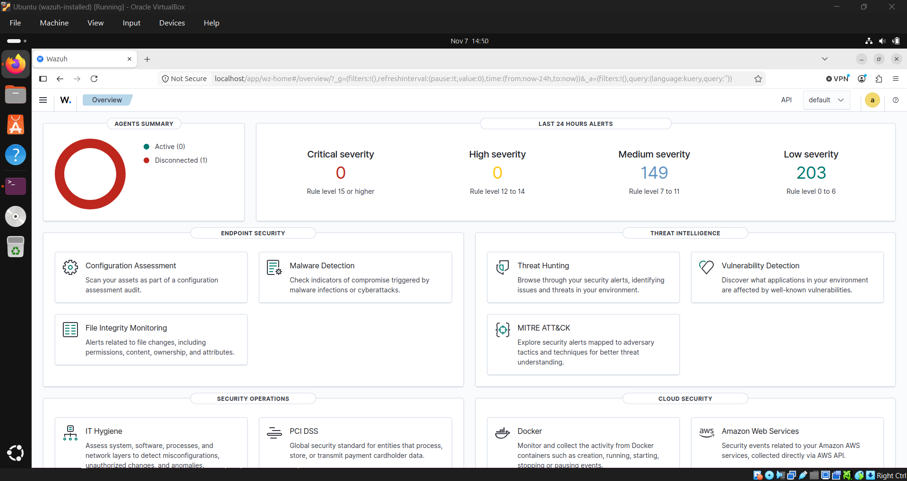
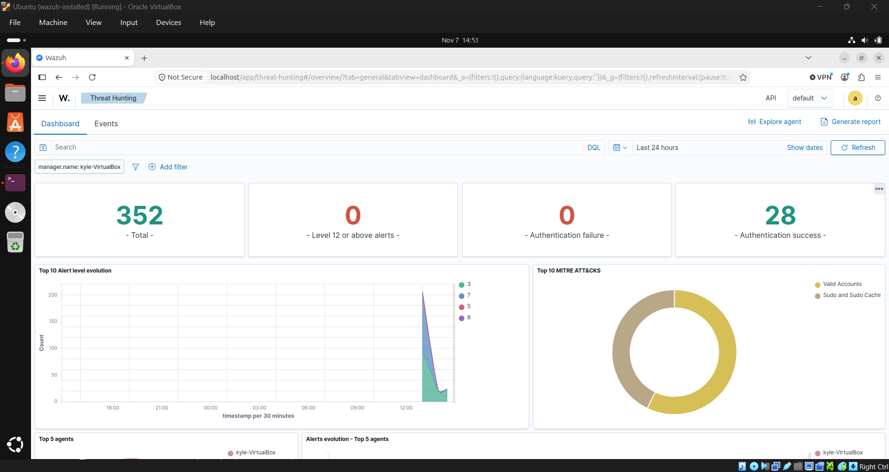
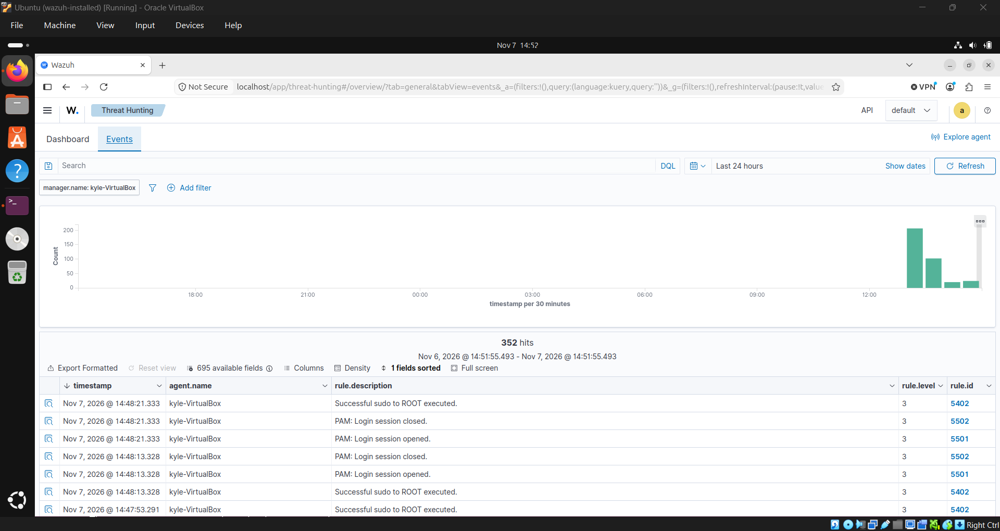
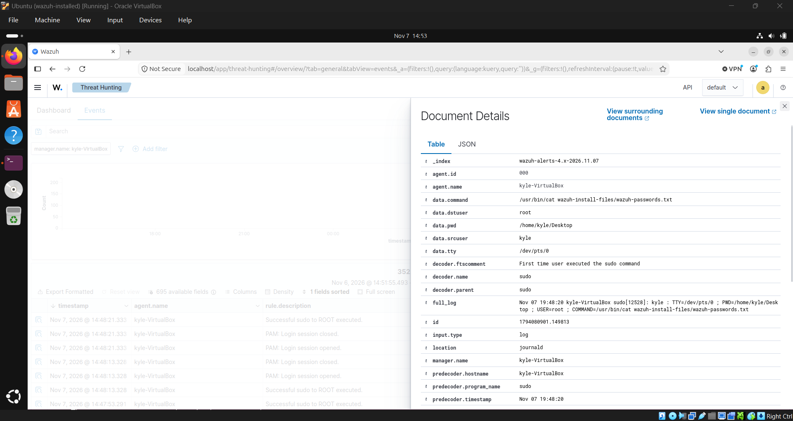
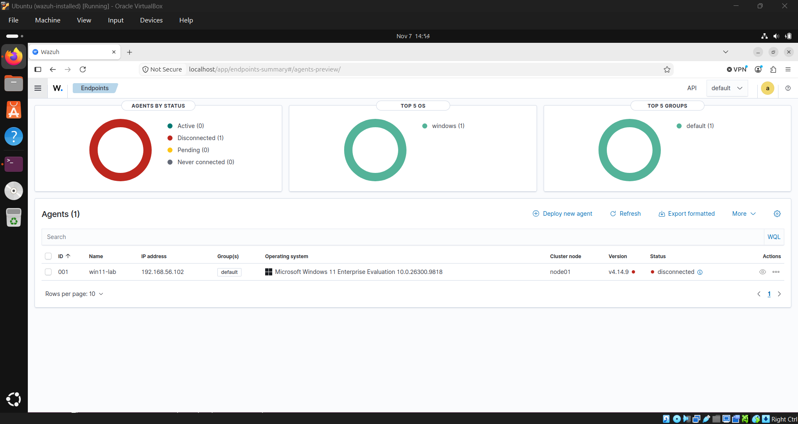

# Wazuh SIEM Lab

## Overview

This project documents the deployment and operation of a Security Information and Event Management (SIEM) home lab using Wazuh.

The lab was built to gain hands-on experience with:

- Security Monitoring
- Threat Hunting
- Log Analysis
- Endpoint Monitoring
- Incident Investigation
- SIEM Administration

## Environment

| Component | Purpose |
|-----------|----------|
| Ubuntu Linux | Wazuh Server |
| Windows 11 Enterprise | Monitored Endpoint |
| Wazuh Agent | Event Collection |
| Oracle VirtualBox | Virtualization Platform |
| Wazuh Dashboard | Security Monitoring |

## Skills Demonstrated

- SIEM Administration
- Security Monitoring
- Threat Hunting
- Event Analysis
- Incident Investigation
- Linux Administration
- Windows Endpoint Monitoring

## Screenshots

### Wazuh Overview Dashboard

### Threat Hunting Dashboard

### Events View

### Event Details

### Windows Endpoint Monitoring

## Key Findings

- Deployed a Wazuh SIEM server on Ubuntu Linux
- Connected and monitored a Windows 11 endpoint
- Collected and analyzed security events
- Investigated authentication and privilege escalation activity
- Performed threat hunting using Wazuh dashboards
- Reviewed MITRE ATT&CK mappings

## Lessons Learned

This project provided practical experience with SIEM deployment, endpoint monitoring, event investigation, and Security Operations Center (SOC) workflows.

## Future Enhancements

- Sysmon Integration
- Multi-endpoint monitoring
- Active Directory integration
- Custom detection rules
- Attack simulations
- Vulnerability management workflows
